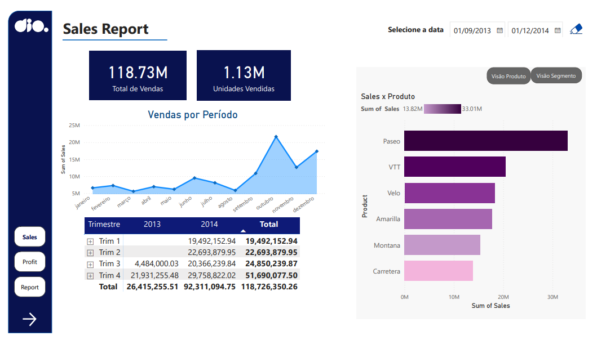

# Power BI UX Redesign — Part 2 | DIO Lab

### Taking an existing report and giving it a fresh look!

Another project completed as part of my **DIO Power BI Bootcamp**! 🤩

This challenge was similar to my previous UX project, but with one interesting difference.

**This time, I wasn't redesigning my own report. I was redesigning one created by our tutor!**

We were given an existing Power BI report and encouraged to improve its user experience, applying what we'd learned about positioning, contrast, proportions, visual hierarchy and navigation.

The original report already contained useful financial information and several interactive features.

But looking at it from a user's perspective, I felt there was still room for improvement.

So I decided to give it my own interpretation!

## My redesigned report

  

*My updated version of the DIO Financial Sample report, with a cleaner layout, improved contrast and more consistent navigation.*

The report uses Microsoft's Financial Sample dataset and contains three pages:

- **Sales:** An overview of sales performance by product, segment and time.
- **Profit:** A more detailed look at profitability across different business dimensions.
- **Report:** Additional charts and financial comparisons for further exploration.

## Starting with the original design

The tutor's report included KPI cards, charts, a matrix, navigation buttons and different ways of exploring the data.

It was a useful starting point, but I noticed a few things I wanted to change.

The original design used a lot of purple, with some charts displayed against purple backgrounds. Although visually striking, I found that the colours sometimes made the information harder to read.

There were also quite a few decorative elements competing for attention.

And that got me thinking:

**What if I kept the useful functionality but made the information itself the main focus?**

That became the starting point for my redesign.

## Redesigning the Sales page

I began by simplifying the layout and making the information easier to scan.

I kept the two main KPI cards:

- **Total Sales:** £118.73M
- **Units Sold:** 1.13M

I also retained the monthly sales chart, quarterly matrix and product/segment comparison.

Rather than placing these elements against a heavily coloured background, I used a predominantly white canvas with navy and blue accents.

I wanted the report to feel lighter and give the charts more breathing room.

The result was a page where the main figures are immediately visible, followed by the visualisations that explain them.

## Improving the Profit page

The Profit page was another interesting part of the challenge.

The original report included a waterfall chart, treemap, decomposition tree and a custom radar visual.

However, the radar visual wasn't displaying correctly in the original report, so I focused on presenting the remaining analytical content more clearly.

I reorganised the page to give the waterfall chart, treemap and decomposition tree more distinct areas.

The waterfall chart shows how profit accumulates across quarters, while the treemap provides a view of profit by business segment.

The decomposition tree allows further exploration of profit by year and country.

I wanted to preserve the analytical possibilities without making the page feel overwhelming.

## Updating the detailed Report page

For the third page, I retained the main financial comparisons.

These include:

- Sales and profit over time
- A quarterly financial matrix
- Sales compared with gross sales

I worked on simplifying the visual containers and making the charts easier to distinguish from one another.

This was also a reminder that good report design involves balancing detail with readability.

Sometimes the challenge isn't deciding what to add, but deciding how much information should be visible at once.

## Making the design more consistent

Across all three pages, I focused on a few principles.

**Contrast:** I moved away from heavily coloured backgrounds and used lighter surfaces with darker text.

**Positioning:** I reorganised charts and other visual elements to create a clearer reading order.

**Consistency:** I kept a similar visual style and navigation structure across the pages.

**Simplicity:** I reduced unnecessary decoration so the data could take centre stage.

**Functionality:** I wanted to preserve the useful interactive features of the original report rather than redesign it purely for appearance.

One of the biggest lessons from this challenge was that **a report doesn't need more colours, shapes or effects to become more interesting. Sometimes removing things makes it much more effective!**

## Comparing the two versions

Looking at the original and redesigned reports side by side, I can see a noticeable difference.

The original was more decorative and visually busy.

My version uses a more restrained colour palette, clearer separation between visualisations and a more consistent layout.

I also learned that improving UX doesn't necessarily mean replacing every visual.

Sometimes an existing chart is perfectly suitable. It simply needs better positioning, formatting or context.

## What I would improve next time

There are still areas I'd like to explore further.

### 1. More consistent language

The report contains a mixture of Portuguese and English labels.

In a future version, I would standardise the language and replace technical labels such as "Sum of Sales" with clearer business terminology.

### 2. Better date presentation

Some charts contain crowded month labels.

I'd like to experiment with date hierarchies and shorter labels to make time-based comparisons easier to follow.

### 3. Alternative visualisations

Although the treemap works, smaller business segments are more difficult to compare.

Next time, I'd test whether a sorted bar chart communicates the differences more effectively.

### 4. More interaction testing

I'd also like to spend more time testing bookmarks, navigation buttons, slicers and how the visuals respond to user selections.

### 5. Accessibility

I'd like to explore colour contrast, font sizes and other accessibility considerations more systematically.

## What I learned

This project helped me practise:

- Evaluating an existing dashboard from a user's perspective
- Improving contrast and readability
- Creating a clearer visual hierarchy
- Reorganising charts and KPI cards
- Working with matrices, treemaps and waterfall charts
- Preserving analytical functionality during a redesign
- Applying consistent navigation and formatting
- Identifying opportunities for further UX improvements

But my biggest takeaway was this:

**Just because a dashboard works doesn't necessarily mean it's easy to use.**

And just because a design was created by someone more experienced doesn't mean there isn't room to question it, experiment and explore other approaches.

I really enjoyed having the freedom to make my own decisions, especially knowing there wasn't just one correct way to approach the challenge.

Another opportunity to learn, investigate and improve! 😊

---

## Project files

- `second_updating_report_for_UX_DIOlab.pbix` — The updated interactive Power BI report.
- `second_updating_report_for_UX_DIOlab.pdf` — PDF export of the three redesigned pages.
- `second_updating_report_for_UX_DIOlab.PNG` — Screenshot of the redesigned report.

*Created as part of the DIO Power BI Bootcamp using Microsoft's Financial Sample dataset.*

*Original report design provided as part of the DIO learning challenge. Redesign and UX decisions completed independently.*
